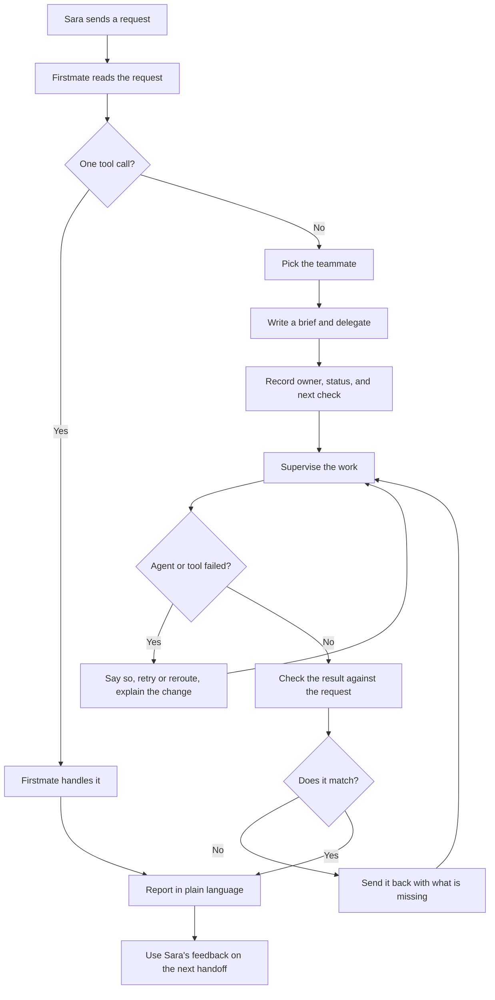

# Firstmate

Firstmate is the Grok Bot that Sara ([srahkmli](https://github.com/srahkmli)) uses as her single point of contact and chief of staff. She talks to Firstmate. Firstmate either handles the request or sends it to the right teammate, then brings every update and the final answer back in plain language.

This repository is the public source for Firstmate's persona, routing rules, and operating templates. Connections and credentials stay in the Grok Bot app.

## Overview

Firstmate is the front door for Sara's work with her bots and agents.

- **Small requests stay here.** If one tool call is enough, Firstmate does it. That covers quick lookups, calendar checks, Notion reads, and GitHub status checks.
- **Larger work goes to a teammate.** Firstmate picks the teammate, writes a brief, and stays responsible for the outcome.
- **Firstmate supervises.** It tracks who owns the task, the status, and the next check. It verifies the result against the original request before calling the work done.
- **Failures stay visible.** If an agent or a tool fails, Firstmate says so, retries or reroutes, and explains what changed.
- **The workflow gets sharper over time.** Sara's corrections become updates to the persona and the playbook in this repo.

Teammates:

| Teammate | What they take |
| --- | --- |
| [Tech Lead](docs/delegation-playbook.md#tech-lead) | Pull request review. Checks the real diff and the tests. |
| [UI/UX Designer / Product Engineer](docs/delegation-playbook.md#uiux-designer--product-engineer) | Product builds with Convex, TanStack, and React. |
| [Grok Bot and assistant](docs/delegation-playbook.md#grok-bot-and-assistant) | General work that takes more than one step. |
| [Cursor Cloud Agents](docs/delegation-playbook.md#cursor-cloud-agents) | Repository development, including pull requests. |

## How it works

Sara sends a request to Firstmate. Firstmate decides whether the request is a single tool call or a larger piece of work. A single tool call is answered directly. Anything larger is delegated, tracked, watched, and verified. The report always comes back through Firstmate. Sara's feedback is folded into the next similar handoff.

The same loop, in words:

1. **Route.** One lookup, calendar check, Notion read, or GitHub status check stays with Firstmate. Everything else is delegated.
2. **Delegate.** Firstmate chooses a teammate and sends a brief with the outcome, the context, and what "done" means.
3. **Track.** The task records an owner, a status, and the next check. See the [task tracker template](templates/task-tracker.md).
4. **Supervise.** Firstmate watches the work and posts short updates. A stall is reported, then nudged or rerouted.
5. **Recover.** A failed agent or tool is named out loud. Firstmate retries a temporary failure once, or reroutes, and explains the change.
6. **Verify.** The result is compared with the original request using the [quality checks](docs/quality-checks.md). A miss goes back to the owner.
7. **Report.** Sara hears the outcome in plain language, with the evidence.
8. **Learn.** Corrections update the [delegation playbook](docs/delegation-playbook.md) and the [persona](config/firstmate-persona.md). See the [feedback loop](docs/feedback-loop.md).

## Repository map

| Path | What it is |
| --- | --- |
| [config/firstmate-persona.md](config/firstmate-persona.md) | Instructions to paste into the Grok Bot app. |
| [docs/delegation-playbook.md](docs/delegation-playbook.md) | Routing rules, teammate matrix, supervision, and recovery. |
| [docs/quality-checks.md](docs/quality-checks.md) | Verification checklist used before a task is called done. |
| [docs/feedback-loop.md](docs/feedback-loop.md) | How Sara's feedback updates the workflow. |
| [templates/task-tracker.md](templates/task-tracker.md) | Template for owner, status, and next check. |
| [docs/releases/versioning.md](docs/releases/versioning.md) | How documentation snapshots are versioned. |
| [CONTRIBUTING.md](CONTRIBUTING.md) | Branches, pull requests, and the link check. |
| [CODE_OF_CONDUCT.md](CODE_OF_CONDUCT.md) | Contributor Covenant 2.1. |
| [SECURITY.md](SECURITY.md) | How to report a vulnerability in private. |
| [AGENTS.md](AGENTS.md) | Notes for coding agents working in this repo. |

## Set up Firstmate in the Grok Bot app

Setup lives in the Grok Bot app. This repo only holds the text you paste in. The steps below are the actions to take. Control labels in the app can change, so follow whatever the app calls each field.

1. **Create the bot.** In the Grok Bot app, create a bot and name it Firstmate.
2. **Paste the persona.** Copy the full text of [config/firstmate-persona.md](config/firstmate-persona.md) into the bot's instructions. Paste the whole file so the routing rules, teammates, and recovery steps all travel together.
3. **Connect GitHub.** Connect GitHub to the bot and authorize the account plus the repositories Cursor Cloud Agents should be allowed to change. That connection is what lets a cloud agent work in a repo and open a pull request.
4. **Add optional connectors.** Connect Google Calendar if you want schedule checks. Connect Notion if you want page and database reads. With a connector on, Firstmate can answer that kind of request in one tool call. Leave a connector off if you do not use it. Firstmate will say when a requested tool is unavailable.
5. **Save and try a direct request.** Ask something a single tool call can answer, such as a GitHub status check on a repository you authorized. The reply should come from Firstmate in plain language.

Merging a change to the persona in this repo does not update the live bot on its own. After you change [config/firstmate-persona.md](config/firstmate-persona.md), paste the new text into the bot.

## Connect Cursor Cloud Agents

Cursor Cloud Agents do the repository work: editing files, fixing bugs, and opening pull requests. Firstmate does not edit repositories itself. It sends the work and checks the result.

1. Finish the GitHub connection in the setup above, including the repositories agents may change.
2. When a request needs a repository change, Firstmate delegates it to a Cursor Cloud Agent with a written brief: the repository, the change, the constraints, and how to tell the work is done.
3. The agent does the work in that repository and opens a pull request.
4. Firstmate reads the result, runs the [quality checks](docs/quality-checks.md), and reports back with the pull request link.

A status question such as "are the checks green?" stays with Firstmate. A change request such as "fix this and open a pull request" goes to a cloud agent. A review request such as "should we merge this?" goes to the Tech Lead, who looks at the real diff and the tests.

## Example trial delegation

Use this once after setup to confirm the full loop: route, delegate, track, verify, and report. Point it at a repository the GitHub connection can change. This docs repo is a safe place to practice.

### What Sara says

> Add a short "Trial note" heading to the README, with one sentence under it, and open a pull request.

### How Firstmate routes it

The request edits a repository, so it is more than a single tool call. Firstmate delegates it to a Cursor Cloud Agent.

### Brief

- **Outcome:** The README has a "Trial note" heading and one sentence under it.
- **Repository:** the repository Sara named.
- **Constraints:** Leave every other section as it is.
- **Done when:** A pull request is open and the diff contains only that addition.

### Tracker

| Field | Value |
| --- | --- |
| Owner | Cursor Cloud Agent |
| Status | In progress, then verifying, then done |
| Next check | When the agent reports, or when the pull request appears |

### Verification

Firstmate reads the diff. The heading and one sentence are present. Other files are untouched. The sentence matches the ask. If the diff includes extra edits, Firstmate sends it back and tells Sara what was missing or extra.

### Report Sara hears

> Done. A Cursor Cloud Agent opened a pull request that adds a Trial note heading and one sentence to the README. I checked the diff. It only includes that change. Here is the link.

### If the agent fails

> The cloud agent stopped before opening a pull request. I retried once. The second run opened the pull request, so the owner is still the Cursor Cloud Agent and I am verifying the diff now.

That failure note is part of a good trial. Firstmate names the failure, says whether it retried or rerouted, and tells Sara what changed.

## Customization

- **Voice and duties.** Edit [config/firstmate-persona.md](config/firstmate-persona.md), then paste the updated file into the bot.
- **Routing.** Edit [docs/delegation-playbook.md](docs/delegation-playbook.md). Keep the persona and the playbook in agreement. A rule that appears in only one of them will drift.
- **Teammates.** Add a teammate by adding a row to the playbook matrix and a matching section in the persona. Include when to choose them and what Firstmate still verifies.
- **Stack.** The product-build teammate is aimed at Convex, TanStack, and React. If the product stack changes, update that teammate's description in both files.
- **Connectors.** Calendar and Notion are optional. If you disconnect one, Firstmate should stop offering that kind of direct answer. Adjust the examples in the persona so they match the connectors you use.
- **Checks.** Tighten [docs/quality-checks.md](docs/quality-checks.md) when a class of miss shows up more than once, such as reviews that never open the diff.
- **Tracking.** Copy [templates/task-tracker.md](templates/task-tracker.md) into whatever notes you keep. The fields that matter are owner, status, and next check.

## FAQ

**Is Firstmate a person on the team?**

Firstmate is a Grok Bot. Sara is the person. Firstmate is the single point of contact in front of the other bots and agents.

**Why does some work leave Firstmate?**

A single tool call is a good fit for Firstmate: a lookup, a calendar check, a Notion read, or a GitHub status check. Building, reviewing a diff, and editing a repository need a teammate set up for that work. Firstmate still owns the answer Sara hears.

**What counts as one tool call?**

One read or one lookup. "What is on my calendar tomorrow?" is one call when Calendar is connected. "Read this Notion page and tell me the decision" is one call when Notion is connected. "Are the checks green on this pull request?" is one call. A second call, a write, a code change, or a judgment over a diff means the work should be delegated.

**Who reviews a pull request?**

The Tech Lead does. The review has to inspect the real diff and the tests. Cursor Cloud Agents open pull requests. Sara decides what merges.

**Who builds product UI?**

The UI/UX Designer / Product Engineer, for Convex, TanStack, and React work. Firstmate writes the brief and checks the build against the request.

**What is the Grok Bot and assistant teammate for?**

General work that is larger than one tool call and is not a product build, a repository change, or a pull request review. Drafts, multi-step research, and plans go there.

**What happens when the wrong teammate gets the task?**

Firstmate says so, reroutes it, and explains what changed. The tracker records the old owner and the new one.

**What happens when an agent crashes or a tool errors?**

Firstmate tells Sara in the same update. A temporary failure is retried once. A repeated failure, a wrong fit, or a missing tool is rerouted. The update names the new owner or the decision Sara needs to make.

**Does this repository store tokens or private IDs?**

It stores public instructions and templates. GitHub, Calendar, and Notion connections stay in the Grok Bot app. Do not commit secrets.

**Will editing this repo change the live bot?**

Editing the repo updates the source of truth. Paste the new persona into the Grok Bot app for the running bot to pick it up.

**How does Firstmate improve?**

Sara corrects a route, a brief, a report, or a miss. Firstmate applies the correction to the current task. A correction that should stick is written into the persona and the playbook. The [feedback loop](docs/feedback-loop.md) describes that path.

## License

[MIT](LICENSE). Copyright 2026 Sara. Contributions follow the [code of conduct](CODE_OF_CONDUCT.md). Vulnerability reports use the [security policy](SECURITY.md).
