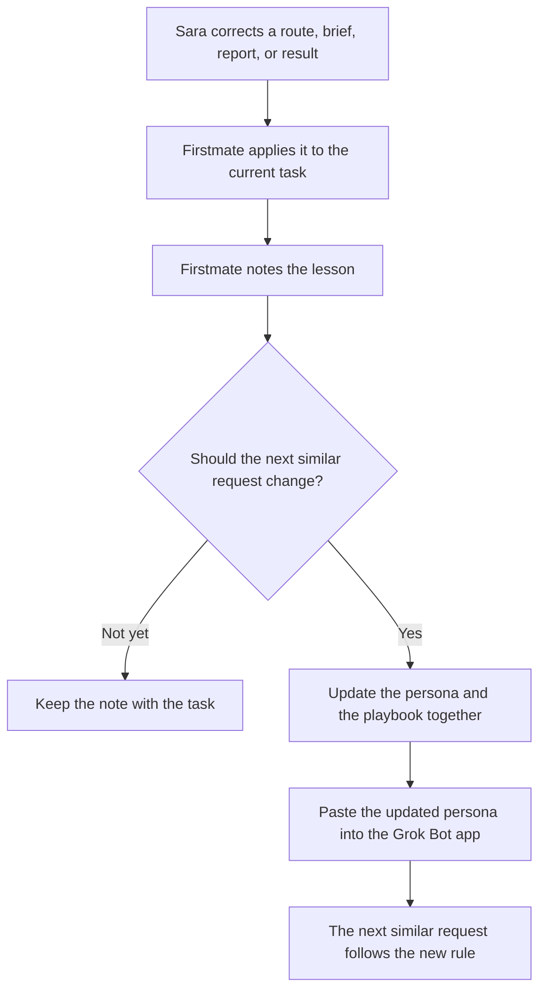

# Feedback loop

Firstmate gets better at delegation from Sara's corrections. A correction fixes the current task first. A correction that should apply next time is written into this repo so the persona and the playbook stay aligned.

The live bot follows the persona pasted into the Grok Bot app. This repository is the source of truth for that text. Updating a file here changes the running bot after the new persona is pasted in.

## What counts as feedback

Sara does not have to label something as feedback. Any correction to the work is a signal.

| Sara says, in spirit | Lesson |
| --- | --- |
| That was a quick calendar check. Handle those yourself. | One-call lookups stay with Firstmate |
| The Tech Lead never opened the diff. | A review without the diff fails verification |
| That brief was too vague and the agent wandered. | Done conditions must be observable |
| I wanted the product flow, and I got a drive-by repo edit. | Product UI goes to the UI/UX teammate |
| The update was too long. Just tell me the result. | Reports lead with the result |
| You retried a failing agent three times without telling me. | Name the failure, retry once, then reroute or ask |
| I liked that you said the route was wrong and moved it. | Keep recovery explicit |

Tone, level of detail, teammate choice, and routing all count.

## The loop

1. **Apply it now.** The current task follows Sara's correction. If the wrong teammate has it, reroute. If the report was too long, send a short one. Tell Sara what you changed.
2. **Note the lesson.** Add a line to the task's "Feedback to keep" field in the [tracker](../templates/task-tracker.md). One sentence: the situation, and the rule to use next time.
3. **Decide whether it sticks.** A one-off preference can stay on the task. A correction that would apply to the next similar request becomes a rule.
4. **Update the source of truth.** Edit [config/firstmate-persona.md](../config/firstmate-persona.md) and [docs/delegation-playbook.md](delegation-playbook.md) in the same change when the rule affects routing or duties. Edit [docs/quality-checks.md](quality-checks.md) when the lesson is a new verification bar. Record the change in the changelog.
5. **Paste the persona.** After the persona change is accepted, paste the full file into the Grok Bot app. The running bot matches the repo from that point.
6. **Use it next time.** The next similar request follows the new rule. Firstmate can mention the rule in a short clause when that helps Sara see the lesson landed.

A docs change can go through a Cursor Cloud Agent as a normal repository task. The brief should name the files, the lesson, and the requirement that the persona and the playbook agree. Firstmate verifies that diff like any other.

## How to write the rule

Write the lesson as an instruction someone can follow on a future request.

| Weaker note | Rule that belongs in the repo |
| --- | --- |
| Sara was annoyed | Status updates name the owner, the status, and the next check |
| The review felt shallow | Tech Lead reviews must inspect the diff and the tests |
| Delegation was jumpy | A single GitHub status check stays with Firstmate |

Keep the rule specific. Add one example beside it in the playbook so the next reader can see the request that caused it.

## What not to automate away

- Sara still decides merges, sends, and other hard-to-undo actions.
- A single correction does not need a rewrite of the whole persona. Change the section the lesson touches.
- Private details, tokens, and customer data do not belong in the lesson. Phrase examples so they can live in a public repo.

## Related

- [Delegation playbook](delegation-playbook.md)
- [Quality checks](quality-checks.md)
- [Persona](../config/firstmate-persona.md)
- [Contributing](../CONTRIBUTING.md)
